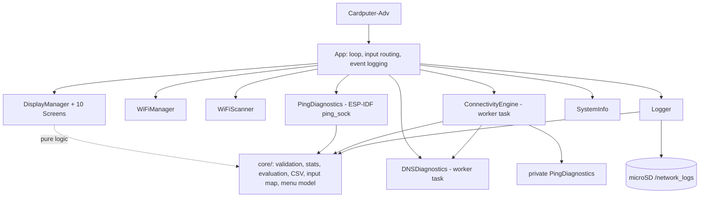

# Portable Network Diagnostic Terminal

A portable ESP32-S3 based network diagnostic and monitoring terminal for authorized Wi-Fi connectivity analysis, troubleshooting, and diagnostic logging. Target hardware: **M5Stack Cardputer-Adv**.

> **Project status (read first):** the firmware compiles for the ESP32-S3 and the
> hardware-independent logic has passing unit tests. **Nothing has been run on a physical
> Cardputer-Adv yet.** Every hardware-facing feature below is therefore marked
> *NOT HARDWARE-TESTED* until you work through
> [`docs/hardware-test-checklist.md`](docs/hardware-test-checklist.md). No screenshots are included for the same reason.

## Overview
A keyboard-driven, pocket-sized tool that answers "why is this network not working?" layer by layer: Wi-Fi association, gateway, DNS, internet. It also scans for nearby networks, runs ICMP ping and DNS tests, and logs results to microSD as CSV.

## Problem statement
Diagnosing a flaky network normally needs a laptop. A small self-contained device that tells you *which layer* is failing (and logs it) is useful for home, lab and classroom troubleshooting.

## Objectives
Correctness and reliability over feature count; modular, testable code; honest documentation of limits; no offensive functionality.

## Features
| Feature | Status |
|---|---|
| Boot self-test (display, Wi-Fi, SD, battery) | IMPLEMENTED + NOT HARDWARE-TESTED |
| Menu, keyboard navigation, text input | IMPLEMENTED + NOT HARDWARE-TESTED (key mapping logic: unit-tested) |
| Wi-Fi scan (SSID, RSSI, channel, auth; no neighbour BSSIDs) | IMPLEMENTED + NOT HARDWARE-TESTED |
| Wi-Fi connect (config.h or on-device entry, RAM only) | IMPLEMENTED + NOT HARDWARE-TESTED |
| Network info (SSID, IP, mask, GW, DNS, RSSI, channel, auth, MAC; `N/A` when unknown) | IMPLEMENTED + NOT HARDWARE-TESTED |
| Ping (ICMP, IPv4/hostname, 1-20 packets, min/avg/max/loss) | IMPLEMENTED + NOT HARDWARE-TESTED (statistics: unit-tested) |
| DNS test | IMPLEMENTED + NOT HARDWARE-TESTED |
| Gateway reachability (ICMP) | IMPLEMENTED + NOT HARDWARE-TESTED (part of Connectivity) |
| Layered connectivity test | IMPLEMENTED + NOT HARDWARE-TESTED (decision logic: unit-tested) |
| Network health summary (heuristic score) | IMPLEMENTED + NOT HARDWARE-TESTED (scoring: unit-tested) |
| microSD CSV logging + log viewer | IMPLEMENTED + NOT HARDWARE-TESTED (formatting: unit-tested) |
| System info (board, chip, CPU, flash, heap, battery, uptime) | IMPLEMENTED + NOT HARDWARE-TESTED |
| Standalone gateway-only screen | NOT IMPLEMENTED (gateway is shown inside Connectivity) |

## Hardware
M5Stack Cardputer-Adv (ESP32-S3, 240x135 display, keyboard, microSD slot). A FAT32 microSD card is optional (logging only).

## Software stack
C++17, Arduino framework on `espressif32@6.9.0` (Arduino-ESP32 2.0.17 / ESP-IDF 4.4.7), M5Cardputer + M5Unified + M5GFX (pinned to commits), ESP-IDF `ping_sock` for ICMP, Unity for host tests.

## Architecture

Details: [`docs/architecture.md`](docs/architecture.md).

## Installation / PlatformIO setup
1. Install [PlatformIO Core](https://platformio.org/install/cli) or the VS Code extension.
2. `git clone` this repository.
3. `cp include/config.example.h include/config.h` (optional: set your own Wi-Fi; `config.h` is git-ignored).

## Build / flash
```bash
pio run -e cardputer-adv                 # build
pio run -e cardputer-adv -t upload       # flash (hold G0 while plugging in USB if the port is not detected)
pio device monitor
```
Host tests (no board needed): `pio test -e native` or `UNITY_DIR=/path/to/Unity scripts/run_host_tests.sh`.

## Usage
| Key | Action |
|---|---|
| `;` / `.` (or Fn+`;` / Fn+`.`) | Up / Down |
| `,` `/` (or Fn+`,` Fn+`/`) | Left / Right (log viewer scroll) |
| Enter | Select |
| Esc (Fn+`` ` ``) or Backspace | Back |
| `r` | Refresh / re-run |
| `c`, Fn+Backspace | Clear (field) |
| Tab | Show/hide password |

In text fields every key is literal text; Enter confirms, Esc cancels, Backspace deletes.

## Example workflow
1. *WiFi Scan* -> pick your network -> Enter -> type the password.
2. *Connectivity*: see which layer fails (e.g. `DNS FAILURE`).
3. *Ping Test* `8.8.8.8 10` to look at latency/loss; *DNS Test* `example.com`.
4. *Logs* to confirm records were written; read the CSVs on a PC.

## Screenshots
None yet (see `screenshots/README.md`).

## Project structure
`src/core` pure logic (host-tested) - `src/network` Wi-Fi/ping/DNS/connectivity - `src/ui` display + screens - `src/storage` logger - `src/system` device info - `test/` Unity tests - `docs/`.

## Testing
60 host unit tests (validation, ping stats, connectivity decisions, health heuristic, CSV/timestamps, text input, menu model, argument parser, key mapping). Hardware behaviour must be verified with the checklist.

## Troubleshooting
See [`docs/troubleshooting.md`](docs/troubleshooting.md).

## Limitations
- ICMP: RTT has 1 ms resolution (sub-ms LAN replies show `0 ms`); "unreachable" and "timeout" cannot be told apart.
- Some routers/networks drop ICMP; the tool then reports gateway failure while still saying ONLINE if DNS+internet work, and the internet layer falls back to TCP/443.
- DNS: the Arduino API returns only success/failure; "not found" vs "timeout" is inferred from response time. lwIP caches answers, so repeats can be near 0 ms.
- Wi-Fi: 2.4 GHz only (ESP32-S3). Power-save is disabled for accurate latency, which raises power use.
- The health score is a heuristic of my own design, not a standard.
- Display layout (26 columns, scaled 6x8 font) has not been checked on the real panel; the layout constants may need tuning.
- Not an enterprise monitoring tool.

## Security and authorized-use statement
Use only on networks you own or are explicitly authorized to test. The project contains no password cracking, deauthentication, packet injection, evil-twin, credential collection, or disruption features, and none will be accepted. Wi-Fi credentials entered on the device stay in RAM and are never written to flash or SD (`WiFi.persistent(false)`). Scan logs contain nearby SSIDs: do not publish them. CSV fields are neutralised against spreadsheet formula injection (SSIDs are attacker-controlled).

## Future improvements (FUTURE WORK, not implemented)
History graphs, diagnostic profiles, BLE diagnostics, local web dashboard, exportable reports, scheduled tests.

## License
MIT - see [LICENSE](LICENSE).
